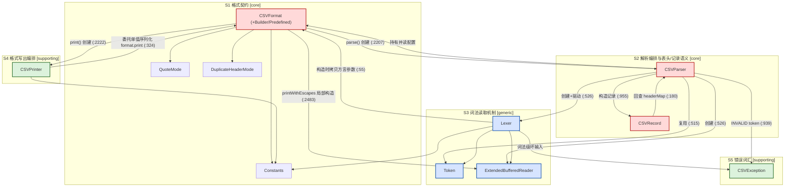
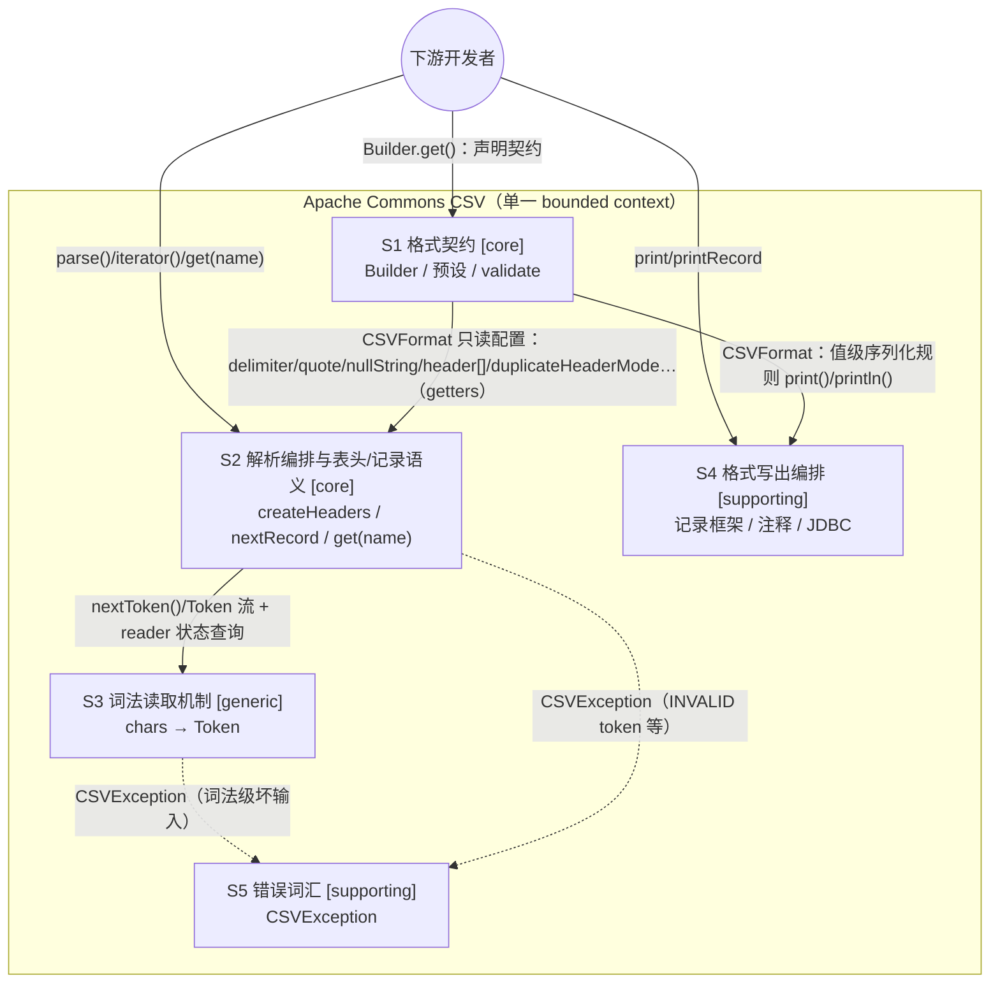

# Apache Commons CSV：Strategic Design 子域识别

> **分析基线**：`./commons-csv`，HEAD `24562da2`（`1.15.0-SNAPSHOT`，生产代码与热身场景文件锚点 `c6ac1bde` 完全一致——两者之间只差一个新增测试文件）。
> **证据口径**：全部结论来自本次对 `src/main/java/org/apache/commons/csv/` 下 12 个 `.java` 文件的完整通读；行为结论另有 `mvn` 实测佐证（全量 `1003 tests / 0 failures / 11 skipped`，2026-10-14）；波动性为 git 历史实测。行号均可在当前 HEAD 复核。
> **写法约定**：DDD 术语首次出现时附白话解释。读者假定为熟悉 Java、未系统学过 DDD 的后端工程师。

---

## 0. 分析前提：把一个"库"当作一个"业务域"来看

DDD 的分析对象通常是"一家公司的业务"。本次分析对象是一个开源库，因此先声明这层**类比映射**，并把它作为全文的假设 A1：

| 业务域概念（Ch.1 原意） | commons-csv 中的对应物 | 类比的局限 |
| --- | --- | --- |
| 公司 | 这个库（一件产品） | 没有财务/组织维度 |
| 客户 | 下游开发者（以及他们的最终用户） | "付钱"译作"愿意引入这个依赖" |
| 竞争对手 | 手写 `split()`、其他 CSV 库（OpenCSV、jackson-dataformats-csv、Super CSV、univocity-parsers）、数据库自带 `COPY` | "竞争优势"译作"选它而不选别的方案的理由" |
| 域专家 | 维护者 + 提 issue 的重度用户 | 需求原文（4.6）正是维护者口吻 |
| 业务活动 | 配置格式、读 CSV、写 CSV | 子域 = 围绕同一批数据的用例簇 |
| "外包/买方案" | "用现成开源组件替代这部分代码" | 判定"能否外包"即"有无现成方案可替换" |

**声明**：这个类比是本文的出发假设，不是事实。它最大的失真在于——真实公司的核心子域会随商业战略漂移，而库的"战略"由维护者社区对采纳度的追求隐性决定。此外，本库并非零依赖（`ExtendedBufferedReader` 继承 commons-io 的 `UnsynchronizedBufferedReader`，打印用到 commons-codec），所以"买方案"在本库里已经发生过（对 commons-io 的依赖可视为一次"采购"）。

---

## 1. 用来验证子域边界的端到端场景

场景清单**直接摘录**自热身产物 `ch02-1-2-scenarios-for-warming-up.md`（18/18 已有特征测试钉住，文件 `src/test/java/org/apache/commons/csv/kata/HeadersCharacterizationTest.java`，本次实测复跑全绿），不重新设计。摘录如下：

| 组 | 场景 | 探测什么 |
| --- | --- | --- |
| A1–A4（R-A5/A6 仅记录） | 表头三种来源：无表头 / `setHeader()` 自动探测首行 / `setHeader("a","b")` 手工指定（± `setSkipHeaderRecord`） | 表头从哪来、映射如何建立 |
| B1–B3（R-B4–B8 仅记录） | `get("nope")` 报错、表头列数≠数据列数、空输入 | "按名取值"的晚失败现状与边界 |
| C1–C3（R-C4/C5 仅记录） | 重复列名 × `DuplicateHeaderMode` 三模式、空/空白列名 | 表头合法性校验的**时机与异常** |
| D1–D2 | 表头名带前后空白、手工表头与文件首行错位 | 将来 required 匹配的语义边界 |

断言口径（热身已确认）：异常**类型精确断言**，消息只断言关键片段。

**交叉验证：这些场景分别落在哪些子域上**（本节新增的分析）：

| 场景组 | 落点 | 验证了什么子域边界 |
| --- | --- | --- |
| A 组 | 配置声明在 **S1**（`Builder.setHeader`），汇合执行在 **S2**（`CSVParser.createHeaders()`，`CSVParser.java:628-683`：635 行自动探测分支、643-649 行手工+skip 分支） | "契约的**声明**"与"契约的**执行**"分属两个子域，且三来源在 S2 单点汇合 |
| B 组 | **S2**（`CSVRecord.get(String)`，`CSVRecord.java:130-146`；`isConsistent` :237-240） | 按名访问语义整体在 S2，不外溢 |
| C 组 | 手工表头：**S1** 的 `CSVFormat.validate()`（`CSVFormat.java:2791-2804`，build 时抛）；文件表头：**S2** 的 `createHeaders()`（`CSVParser.java:661-669`，parse 时抛） | **同一条规则（重复表头禁令）在 S1、S2 各有一个执行点**——证明"表头规则"天然横跨"配置期可查部分"与"读入期才可知部分"，这条裂缝正是新需求（4.6）要落的位置 |
| D 组 | **S2**（headerMap 的 key 形态：默认不 trim）+ **S1**（`ignoreHeaderCase` 配置改变 S2 的 Map 实现，`CSVParser.java:615-619`） | 匹配语义由 S1 的开关与 S2 的数据结构共同决定 |

结论：四组场景无一需要"词法机制（S3）"或"写出（S4）"参与即可完整解释表头行为——支持把"表头/记录语义"从"读机制/写方向"中切出来单独成域。

---

## 2. 子域清单（含类名、职责、依赖、接口）

**包结构**：单一扁平包 `org.apache.commons.csv`，12 个 `.java`（11 个真实类型 + `package-info.java` 文档）。物理上不分层、不分包，但**可见性分两层**：`public`（`CSVFormat`/`CSVParser`/`CSVPrinter`/`CSVRecord`/`QuoteMode`/`DuplicateHeaderMode`/`CSVException`）对外发布；包私有（`Lexer`/`Token`/`ExtendedBufferedReader`/`Constants`）为内部实现。
**划分粒度**：按"围绕同一批数据、同一批参与者的 coherent use cases"（Ch.1）切成 **5 个子域**；core 挖到类级，generic/supporting 适可而止。

### S1 格式契约（Format Contract）——判定：core

- **包含类**：`CSVFormat`（含内部 `Builder` 与 `Predefined` 枚举）、`QuoteMode`、`DuplicateHeaderMode`、`Constants`
- **职责**：把"一种 CSV 方言 + 表头约定"建模为**不可变值对象**：24 个可组合参数、12 个预设（`DEFAULT`/`EXCEL`/`RFC4180`/`MYSQL`…，`CSVFormat.java:1052-1413`）、参数间不变式的 build 期校验（`validate()`，:2771-2805）。同时**物理承载**了写方向的值级序列化规则（`printWithQuotes` :2551-2650、`printWithEscapes` :2425-2545）——逻辑上这是"契约的执行细则"，与读方向的 `Lexer` 互为镜像。
- **对外接口**：`CSVFormat.builder()`/`Builder.create()`；`Builder` 的 `setDelimiter/setQuote/setEscape/setCommentMarker/setHeader(String...)/setSkipHeaderRecord/setIgnoreHeaderCase/setAllowMissingColumnNames/setDuplicateHeaderMode/setNullString/setQuoteMode/setTrim/setMaxRows` 等 24 个；预设常量 12 个；`CSVFormat.parse(Reader)`/`print(Appendable)` 工厂；`format(Object...)` 便捷方法；约 30 个 getter；deprecated 的 `with*` 家族（1.9 迁移遗留，:2808-3367）。
- **内部依赖**：引用 `QuoteMode`、`DuplicateHeaderMode`、`Constants`；构造 `CSVParser`（`parse` :2207-2209）与 `CSVPrinter`（`print` :2222-2224）；局部构造 `ExtendedBufferedReader`（:2483）。反向：`CSVParser`/`CSVPrinter`/`Lexer` 都持有并读它的配置。

### S2 解析编排与表头/记录语义——判定：core

- **包含类**：`CSVParser`、`CSVRecord`
- **职责**：读方向的**语义中枢**：驱动词法层把字符流装配成记录（`nextRecord()` :915-959）；表头三来源汇合与"名字→下标"映射的建立（`createHeaders()` :628-683，含空名 :655-659、重复名 :661-669、last-wins 写入 :672）；null 字符串语义（`handleNull` :817-830，与 QuoteMode 交互）；把映射借给 `CSVRecord` 提供按名/按标访问、容错查询（`isConsistent`/`isMapped`/`isSet`）、位置/行号/注释附着的记录模型。
- **对外接口**：静态工厂 `parse(File/Path/URL/String/Reader/InputStream,…)` 6 个 + `builder()`；`iterator()/stream()/getRecords()`；`getHeaderMap()/getHeaderNames()/getHeaderComment()/getTrailerComment()`、行号与记录号查询；`CSVRecord` 的 `get(int)/get(String)/get(Enum)`、`isConsistent/isMapped/isSet`、`toList/toMap/putIn/stream/values()`。
- **内部依赖**：持有 `CSVFormat`（只读配置）；构造并驱动 `Lexer`（:526）、构造 `ExtendedBufferedReader`（:526）、复用 `Token`（:515）；构造 `CSVRecord`（:955）；抛 `CSVException`（:939、:950）。**反向依赖（环）**：`CSVRecord` 持有 transient 的 `CSVParser` 引用回查 `getHeaderMapRaw()`（`CSVRecord.java:68、180-182`）。

### S3 词法读取机制（Lexical Machinery）——判定：generic

- **包含类**：`Lexer`、`Token`、`ExtendedBufferedReader`
- **职责**：纯机制层：字符→`Token` 的状态机（引号封装/转义/注释行/多字符分隔符/多行值，`nextToken` `Lexer.java:256-335`）；带前瞻（`peek`）、行号、字符/字节位置计数的缓冲读（`ExtendedBufferedReader`）。
- **对外接口（仅包内）**：`Lexer.nextToken(Token)`、`getCharacterPosition/getCurrentLineNumber/getBytesRead/getFirstEol/isClosed`；`Token.Type` 五态 + 内容缓冲；`ExtendedBufferedReader` 的 `peek(char[])/readLine/getLastChar`。
- **内部依赖**：`Lexer` 构造时从 `CSVFormat` **无转换拷贝**方言参数（:55-67），依赖 `ExtendedBufferedReader`、`Token`、`Constants`，抛 `CSVException`（:397、:411、:528）。`Token` 零依赖（javadoc 自述"lexer 与 parser 之间的契约"，`Token.java:24-29`）。

### S4 格式写出编排——判定：supporting

- **包含类**：`CSVPrinter`
- **职责**：写方向的**编排与胶水**：记录框架（值间分隔、`println`）、注释输出（:230-263）、构造时输出头记录（:120-122）、JDBC `ResultSet` 适配（:287-297、:504-553）、`ReentrantLock` 并发保护。**单值如何转义/加引号并不在这里**——它委托回 `CSVFormat.print(value, appendable, newRecord)`（:323-326）。
- **对外接口**：构造器、`print(Object)`、`printComment`、`printRecord(Object.../Iterable/Stream)`、`printRecords(Object.../Iterable/Stream/ResultSet/ResultSet,boolean)`、`printHeaders(ResultSet)`、`close/flush/getOut/getRecordCount`。
- **内部依赖**：持有 `CSVFormat`（既是配置来源又是序列化规则的执行者）。不依赖解析方向任何类。

### S5 错误词汇（微型支撑域）——判定：supporting

- **包含类**：`CSVException`（1.12 引入，继承 `IOException`，带 `String.format` 风格构造器，`CSVException.java:31-44`）
- **职责**：库统一的"坏输入"异常词汇；被 S3 的 `Lexer` 与 S2 的 `CSVParser` 抛出；S1 的 build 期校验**不用它**（用 `IllegalArgumentException`）——两类错误词汇并存是刻意的配置期/读入期分界。
- **distill 到此为止**：继续往下挖（比如拆"解析错误/打印错误"）不会产生新的设计决策信息（Ch.1 停掘准则）。`package-info.java` 是纯文档，不算类、不入域。

---

## 3. 类级依赖关系图

箭头 = 直接引用/调用/构造（依据源码逐类核出；`Constants` 被几乎所有类引用，为保图形可读只在代表性位置画出）。

读图要点（对后面判定很重要）：

1. **三对环**：`CSVFormat ↔ CSVParser`、`CSVFormat ↔ CSVPrinter`、`CSVParser ↔ CSVRecord`。这个库用环把"契约/编排/模型"焊在一起——它们本来就是一个内聚功能的不同侧面，硬拆会破坏一起变化的性质（Ch.3 "不要把一个内聚功能拆进多个 bounded context"的类内镜像）。
2. `Lexer` 对 `CSVFormat` 是**单向、只读、无转换**的依赖（构造时拷贝参数），对 S2 只通过 `Token` 这一个窄接口暴露——这是 S3 可判定为 generic 的结构性证据。

---

## 4. 子域层面的依赖关系与"接口"

**bounded context 澄清（4.2 第 5 条要求的声明）**：commons-csv 整体是**一个 bounded context**（模型边界 = 一个包；部署边界 = 一个 jar；团队边界 = Apache Commons 同一组维护者；内部用一套一致的 ubiquitous language：format / header / record / delimiter / quote / escape）。因此下文所有子域之间的"接口"都是**同一 context 内部**的契约，不涉及跨团队集成，Ch.4 的整合模式只能作**比喻**使用：

1. **开放主机服务（OHS）/ published language 的比喻**：库把"对外发布的模型"（7 个 public 类型 + `CSVFormat.Builder`）与"内部实现模型"（`Lexer`/`Token`/`ExtendedBufferedReader`/`Constants` 包私有）显式解耦——public API 就是它的 published language，内部实现（例如 1.9 把 `with*` 换成 `Builder`、1.12 重写 `ExtendedBufferedReader` 的字节计数）可以大改而不破坏消费者。
2. **共享内核（shared kernel）的比喻**：`Token` 自述为 "a contract between the lexer and the parser"（`Token.java:27`）。S2 与 S3 共同拥有这份小契约，任何改动必须两侧一起动、跑两侧测试——正是共享内核"公共契约明确划出、必须一起管理"的形态（这里同一团队，通信成本为零，故合理）。
3. **随从者（conformist）的比喻**：`Lexer` 构造时对 `CSVFormat` 的模型照单全收（逐字段拷贝、不做任何翻译转换，`Lexer.java:55-67`）。下游完全接受上游模型、不建防腐层——在本库内部这是对的（同一 BC、模型质量高）；对比之下，**库外**的调用方若担心绑死 commons-csv 的模型，才需要考虑 ACL，那是消费者的事，不是本库的设计决策。

---

## 5. Core / Generic / Supporting 判定

波动性数据为 **git 实测**（`git log --oneline -- <file>`，全历史 3289 commits，其中 1062 触及 `src/main`；训练新增的那条测试提交不触及任何 main 文件，自动排除在计数外）：

| 文件 | 提交总数 | 含 fix/bug/JIRA 关键词的提交 |
| --- | --- | --- |
| `CSVFormat` | **447** | **132** |
| `CSVParser` | **285** | **77** |
| `CSVPrinter` | 165 | 37 |
| `Lexer` | 121 | 39 |
| `CSVRecord` | 120 | 37 |
| `ExtendedBufferedReader` | 83 | 27 |
| `Constants`/`Token`/`QuoteMode`/`DuplicateHeaderMode`/`CSVException` | 35/27/11/6/2 | — |

| 子域 | 判定 | 竞争优势类比（选它不选手写/别库的理由？） | 复杂度 | 波动性（实测） | 能否外包/换现成方案 |
| --- | --- | --- | --- | --- | --- |
| **S1 格式契约** | **core** | **是**：声明式方言 + 12 预设 + 读写共用同一契约对象，是与"手写 split"和其他库拉开差距的第一卖点 | 高：参数不变式矩阵（quote×escape×comment×quoteMode 互斥，`validate()` :2772-2789）+ 表头约定矩阵（allowMissingColumnNames×duplicateHeaderMode×ignoreHeaderCase）+ 值级序列化细则 | **最高**（447/132）：1.9 引入 `Builder`、1.10 引入 `DuplicateHeaderMode`（CSV-264）、1.11 `lenientEof/trailingData`、1.14 `maxRows`——持续加维度的演进从未停 | 否：这就是库本体，无可采购的等价物 |
| **S2 解析编排与表头/记录语义** | **core** | **是**：按名访问 + 表头容错语义是 README 第一课、对账类场景的日常 DX；`get("currency")` 的行为契约是用户感知面 | 高：表头三来源汇合、空/重/缺/大小写矩阵、null 语义×QuoteMode 交互（`handleNull` :817-830）、流式位置/行号追踪 | 高（285/77）：CSV-239（允许重复表头 + `getHeaderNames`）、CSV-264（空白表头识别）都在这层发酵后回灌 S1 | 否：语义规则没有现成实现可买 |
| **S3 词法读取机制** | **generic** | **否**：RFC 4180 是公开规范，每个竞争库都有等价实现；用户不会因为这个词法器更好而选本库 | **高**（注意：generic ≠ 简单）：引号/转义/注释/多字符分隔符/多行值的状态机 + 前瞻缓冲读 + 代理对字节计数 | 中（121/39）：多为"把规范实现对"的修复（短读补齐、CRLF、多字符分隔符边界） | 理论上可整体替换：接口窄（`Token` 契约）、规范驱动、稳定——正是"已被解决过无数次的通用问题"的自建实现 |
| **S4 格式写出编排** | **supporting** | 否：没人为"能写 CSV"单独选它；但"读写对称"这一卖点由 S1 承载，S4 只是兑现它 | 低-中：编排 + 胶水（JDBC 适配、注释格式、锁）；真正难的序列化规则在 S1 | 中（165/37）：多为与读方向对齐的跟进修复 | 无现成胶水可直接复用，必须自写，但逻辑简单、可交给新人 |
| **S5 错误词汇** | **supporting** | 否 | 低：一个异常类 | 极低（2 commits，1.12 新生） | 自写；继续细分无决策价值 |

**我如何避免"代码行数 = 复杂度 = core"这个常见错误**（过程声明）：本文的判定顺序是先问"竞争优势在哪"（S1 的声明式契约、S2 的按名语义），再用复杂度**性质**（业务规则矩阵 vs 机制实现）与波动性实测做交叉验证，行数从未作为输入。两个反例可以直接说明行数会误导：`Lexer`（552 行）与 `CSVRecord`（375 行）行数同量级，判定却一 generic 一 core——判据是"词法是规范驱动的通用机制"对"按名访问是差异化语义"；`CSVFormat` 3369 行中约 600 行是 deprecated `with*` 家族、还有大量重复 javadoc，若按行数加权，会把"历史兼容层"这种最不该投入的代码误判为核心。

---

## 6. 小结表：子域 × 类 × 判定一览

| 子域 | 判定 | 包含的类 | 一句话职责 |
| --- | --- | --- | --- |
| S1 格式契约 | **core** | `CSVFormat`(+`Builder`/`Predefined`)、`QuoteMode`、`DuplicateHeaderMode`、`Constants` | 声明并校验"方言 + 表头约定"这一读写共用契约；承载值级序列化细则 |
| S2 解析编排与表头/记录语义 | **core** | `CSVParser`、`CSVRecord` | 把字符流装配为可按名访问的记录；表头映射、容错、null 与位置语义 |
| S3 词法读取机制 | **generic** | `Lexer`、`Token`、`ExtendedBufferedReader` | 字符→Token 的规范驱动状态机与前瞻缓冲读 |
| S4 格式写出编排 | **supporting** | `CSVPrinter` | 写方向编排：记录框架、注释、头输出、JDBC 胶水 |
| S5 错误词汇 | **supporting** | `CSVException` | 库统一的坏输入异常词汇（读入期） |

> 给后续练习的一句话导航：4.6 的新需求（`setRequiredHeaders`）将横跨 **S1 的 API 表面**与 **S2 的校验时点**，详见 `ch02-2-3-impact-analysis.md`。
