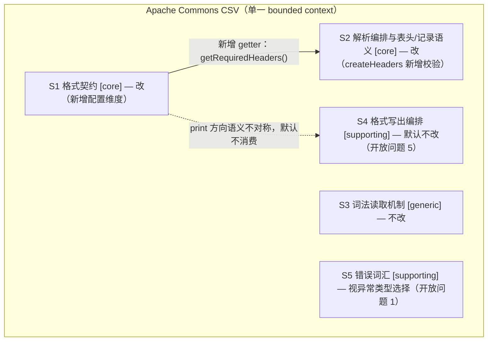
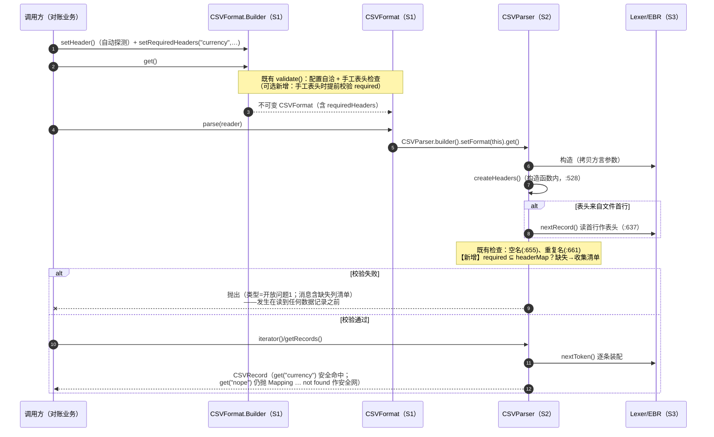

# 新增 "`CSVFormat.Builder.setRequiredHeaders(String...)`" 需求：子域影响分析

> **分析基线**：同 `ch02-2-2-subdomains.md`（HEAD `24562da2`，`1.15.0-SNAPSHOT`）。
> **子域术语**：S1 格式契约（core）/ S2 解析编排与表头/记录语义（core）/ S3 词法读取机制（generic）/ S4 格式写出编排（supporting）/ S5 错误词汇（supporting）。
> **证据口径**：4.6 的现状核查 = 逐行读源码 + 既有测试实测（全量 `1003/0/11` 全绿；针对性复跑 `CSVDuplicateHeaderTest` 348、`CSVRecordTest` 33、kata `HeadersCharacterizationTest` 18 全绿，2026-10-14）。本文不写实现、不改仓库。

---

## 1. 需求复述（用已识别子域的 ubiquitous language 对齐）

需求原文（维护者口吻）逐句翻译成子域术语：

| 需求原文 | 子域术语翻译 |
| --- | --- |
| "给 `CSVFormat.Builder` 加一个 `setRequiredHeaders(String...)`" | 在 **S1** 的契约参数表（Builder 的第 25 个维度）上新增"必需表头名单"这一配置 |
| "解析时一旦发现表头缺少这些列，就……抛出错误" | 校验的**执行**不属于 S1——表头内容的真相在 **S2**（`CSVParser.createHeaders()` 汇合三种来源后才可知） |
| "在读第一条记录之前抛出" | 时点约束 = S2 的 `CSVParser` 构造窗口内（`createHeaders()` 位于构造函数，天然先于任何数据记录） |
| "清楚地说明缺了哪些列" | 错误消息的组织，涉及 **S5** 的词汇选择（`CSVException`）或沿用 `IllegalArgumentException` |
| "而不用等 `record.get("currency")` 时才报 `Mapping for currency not found`" | 把 B1 场景钉住的**晚失败**（`CSVRecord.get(String)`，S2）提前为**读入期早失败**；晚失败本身保留为安全网 |

一句话：**需求挂在 S1 的 API 上，规则落在 S2 的时点上，消息词汇在 S5 与既有 `IllegalArgumentException` 之间选择。**

---

## 2. 现状：表头相关的校验已经发生在哪里

先给 4.6 要求的实地核查结果（全部行号在当前 HEAD 复核过；行为由既有测试实测背书）：

| # | 校验内容 | 发生在哪个类/方法 | 时机 | 抛出什么 |
| --- | --- | --- | --- | --- |
| 1 | **手工表头的重复列名** | `CSVFormat.validate()`（`CSVFormat.java:2791-2804`，由私有构造 :1676 调用，`Builder.get()` :327 触发） | `builder.get()` 构建格式对象时（**配置期**，还没见到任何输入） | `IllegalArgumentException`：`The header contains a duplicate name: "x" in [...]. If this is valid then use CSVFormat.Builder.setDuplicateHeaderMode().`（受 `duplicateHeaderMode` 门控；默认 `ALLOW_ALL` **不查**） |
| 2 | **文件表头的重复列名** | `CSVParser.createHeaders()`（`CSVParser.java:661-669`） | `format.parse(reader)` 创建 `CSVParser` 时（构造函数 :528 调用 `createHeaders()`），**任何数据记录产出之前** | 同款 `IllegalArgumentException`（同受 `duplicateHeaderMode` 门控） |
| 3 | **空/空白列名**（两个来源都覆盖：手工与文件表头都流经同一循环） | `CSVParser.createHeaders()`（`CSVParser.java:655-659`） | 同上（读入期） | `IllegalArgumentException`：`A header name is missing in [...]`（受 `allowMissingColumnNames` 门控，默认 **抛**） |
| 4 | **按名访问找不到列**（需求要替换的痛点） | `CSVRecord.get(String)`（`CSVRecord.java:136-138`） | 业务代码每次调 `get(name)` 时（**晚失败**，逐条记录都可能触发） | `IllegalArgumentException`：`Mapping for %s not found, expected one of %s` |
| 5 | 无表头映射时按名取值 | `CSVRecord.get(String)`（`CSVRecord.java:132-134`） | 同上 | `IllegalStateException`：`No header mapping was specified...` |
| 6 | 映射存在但索引超出记录长度（表头多、数据少） | `CSVRecord.get(String)`（`CSVRecord.java:141-145`） | 同上 | `IllegalArgumentException`：`Index for header '%s' is %d but CSVRecord only has %d values!` |
| 7 | 表头列数 ≠ 数据列数（**隐性缺列**，不抛） | `CSVRecord.isConsistent()`（`CSVRecord.java:237-240`） | 被动查询 | 返回 `false` |
| 8 | 契约自洽性（quote/escape/comment 互斥、`QuoteMode.NONE` 无 escape 等） | `CSVFormat.validate()`（`CSVFormat.java:2772-2789`） | 配置期（build 时） | `IllegalArgumentException` |

**校验时点图景**：配置期（S1，`validate()`，只查"此刻可知的配置自洽 + 手工表头"）→ 读入期（S2，`createHeaders()`，查"见到文件后的表头合法性"）→ 访问期（S2，`CSVRecord.get`，晚失败）。词法级坏输入则是 S3 的 `CSVException`（`Lexer.java:397/411/528`）。

**推理：新校验该插在哪、为什么**（过程，非结论直给）：

1. 需求的硬约束是"读第一条记录**之前**"。追踪读链路：`format.parse(reader)`（`CSVFormat.java:2207`）→ `CSVParser.builder().get()` → 私有构造（`CSVParser.java:524-532`）→ `createHeaders()`（:528）。自动探测模式下 `createHeaders()` 自己会调 `nextRecord()` 读首行（:637）——但那是**表头行**，语义上仍在"第一条数据记录之前"。因此 `createHeaders()` 返回之前是天然插桩窗口。
2. 表头三来源（无 / 自动探测 / 手工，热身 A 组实证）**单点汇合**在 `createHeaders()` 的 `headerRecord`（:631-650）。校验若放在 `createHeaders()` 末尾（`headerMap`/`headerNames` 已定，:682 返回前），三种模式自动全覆盖；若放在 `getRecords()`/`iterator()` 里，则每种消费入口都要重复插桩。
3. 能否更早、放在 S1 的 `validate()`？只有**手工表头**在 build 时已知——这正是重复列名今天的双时机形态（上表 #1 vs #2）。对"自动探测"模式，build 时**不可能**知道文件里有什么列，S1 只能存参数、不能执行校验。
4. 反向排除：`CSVRecord.get(String)` 是需求要**避开**的时点；`Lexer`（S3）只见 token 不见表头语义，放那里会把 S2 的语义泄漏进 S3。
5. ⇒ **API 表面挂 S1（`Builder.setRequiredHeaders` + 字段 + getter），规则执行落 S2（`createHeaders()` 末尾）**；#1 的先例还给出可选加分项——手工表头时在 `validate()` 提前校验（开放问题 3）。

---

## 3. 哪些子域被触碰、哪些不被触碰

| 子域 | 判定（文档 A） | 本次需求是否触碰 | 说明 |
| --- | --- | --- | --- |
| S1 格式契约 | core | **是** | `CSVFormat` 新增 `requiredHeaders` 字段 + `Builder.setRequiredHeaders` + getter + `equals/hashCode/toString/copy/builder` 复制链；（可选）`validate()` 手工表头提前校验 |
| S2 解析编排与表头/记录语义 | core | **是** | `CSVParser.createHeaders()` 末尾新增 required ⊆ 实际表头 的校验；`CSVRecord` **不改**（晚失败保留为安全网） |
| S3 词法读取机制 | generic | 否 | 校验发生在表头语义层，词法层不感知 |
| S4 格式写出编排 | supporting | 默认否 | 写方向的 header 是**输出**不是断言，语义不对称；是否强制写出时也保证 required 见开放问题 5 |
| S5 错误词汇 | supporting | 视选择 | 若选 `CSVException` 则消费它（类本身无需修改，用其格式化构造器即可） |

**关键结论（"API 挂在哪"≠"规则落在哪"）**：需求字面上是 S1 的 API 变更（Builder 加 setter），但**真正的业务规则**（"缺列即在读第一条记录前失败"）必须落在 S2 的 `createHeaders()`——因为表头的真相只有在三种来源汇合之后才存在。若实现者顺着"字面"把校验塞进 `Builder.get()`/`validate()`，自动探测模式将永远无法被校验（build 时看不到文件），需求在最常见的 `setHeader()` 用法下失效。这正是子域视角的价值：它强制你区分"配置的声明"（S1）与"配置对现实的断言"（S2）。

---

## 4. 逐类改动清单

| 类 | 子域 | 是否改动 | 具体改动 | 性质 |
| --- | --- | --- | --- | --- |
| `CSVFormat` | S1 | **改** | 新增 `private final String[] requiredHeaders`；`Builder` 新增字段 + `setRequiredHeaders(String...)`（照 `setHeader` :627-630 的防御性拷贝惯例）；新增 `getRequiredHeaders()`（照 :1899-1901 返回拷贝）；`Builder(CSVFormat)` 复制构造（:284-307）、`equals/hashCode`（:1722-2089）、`toString`（:2701-2748）补维度 | **契约扩展**（新增配置维度，向后兼容） |
| `CSVFormat.validate()` | S1 | 可选改 | 手工表头（`headers != null && headers.length > 0`）时提前校验 required ⊆ headers——与重复列名双时机先例（:2791）对齐 | 行为新增（可选，见开放问题 3） |
| `CSVParser.createHeaders()` | S2 | **改（核心）** | :682 返回前新增：`requiredHeaders` 对照 `headerMap`（注意 `ignoreHeaderCase` 时是 `CASE_INSENSITIVE` TreeMap，:615-619）查缺失，缺失即抛（消息含缺失清单，可选列出实际表头） | 行为新增（需求本体） |
| `CSVRecord` | S2 | **不改** | `get(String)` 晚失败原样保留（B1 场景的安全网，已有特征测试钉住） | 不变 |
| `CSVException` | S5 | 视选择 | 若异常类型选它：无需改类（构造器已支持格式化消息）；若沿用 `IllegalArgumentException`：完全不涉及 | 不变或仅消费 |
| `Lexer` / `Token` / `ExtendedBufferedReader` | S3 | 不改 | — | 不变 |
| `CSVPrinter` | S4 | 默认不改 | （开放问题 5 若要求写出侧保证，再议） | 不变（待决策） |
| `QuoteMode` / `DuplicateHeaderMode` / `Constants` | S1/S3 | 不改 | — | 不变 |
| `kata/HeadersCharacterizationTest` 旁 | 测试 | **新增** | 验收测试（TDD 先行；见第 6 节映射表） | — |

---

## 5. 子域接口变化

**契约如何演进（用 Ch.4 词汇描述，重申：全程在同一个 bounded context 内，以下均为比喻）**：

- S1 对外（对下游开发者）的 **published language（开放主机服务的发布语言）** 发生**纯增量**演进：`Builder` 多一个 `setRequiredHeaders`，既有调用零破坏。这是 OHS 精神下最理想的演进形态——发布语言加维度、不改维度。
- S1→S2 的内部契约（S2 是 S1 配置的**随从者**，照单全收）加一条：S2 现在要消费 `getRequiredHeaders()`。方向不变、无转换层，无需 ACL。
- S2 对外的行为契约变化最大：`parse()` 的可观察行为从"构造成功"变为"构造时可能抛新错误"——但它落在既有先例（`createHeaders()` 已会抛两类 `IllegalArgumentException`）的同一时点，调用方已有的"构造可能失败"心智模型不破坏。

---

## 6. 留给学员现场决定的开放设计问题

以下 6 个问题均**无唯一正确答案**，只摆权衡（按用户要求不给倾向；实现 agent 应把用户的决定写成验收测试）：

1. **异常类型与词汇**：沿用 `IllegalArgumentException`（与 `createHeaders()` 现有两例、`validate()` 全部先例一致；但不是 `IOException` 系）还是 `CSVException`（S5，`IOException` 子类——`parse()` 签名本就 `throws IOException`，调用方现有 catch 可复用，且与词法错误的词汇统一）？权衡：**配置错误语义一致性** vs **读入错误的可捕获性与词汇统一**。
2. **匹配语义**：required 与实际表头如何算"命中"——精确相等（D1 实证默认不 trim，`" currency "` 是独立 key）？trim 后相等？大小写是否跟随 `ignoreHeaderCase`？required 名单自身含重复、或命中重复表头（last-wins，:672）时取哪个索引？权衡：**严格（少惊喜、报错准）** vs **宽容（对脏表头友好，但静默改写语义）**。
3. **校验时机**：只在 S2 `createHeaders()` 统一校验（三种来源行为一致），还是像重复列名那样双时机（手工表头再提前到 S1 `validate()`，配置期 fail-fast）？权衡：**行为一致性** vs **暴露错误的早晚**；报错一次列全缺失 vs 报第一个。
4. **与既有校验的先后与消息组织**：`createHeaders()` 里空名（:655）、重复名（:661）与新增 required 检查谁先抛？错误消息要不要列出实际看到的表头（对账排障友好，但消息更长、可能随版本演进而脆断——热身已确认"类型精确断言、消息只断言关键片段"的口径）？
5. **读写对称性**：`CSVPrinter` 构造时会输出 `format.getHeader()`（`CSVPrinter.java:120-122`）——写方向要不要也校验/保证 required（例如 header 未含 required 时拒绝打印）？权衡：**方向对称的直觉** vs 语义事实（写方向的 header 是**输出物**不是对输入的断言，强校验可能反而碍事）。
6. **配置矛盾与空输入**：`setHeader` 未设（`headers == null`）却设了 required——在 build 时判配置矛盾（fail-fast），还是等 parse 时按"无映射"报？空文件 + 自动探测（B3 实证：`headerMap` 是空 Map 而非 null，:631-633、:682）时必然缺所有 required——这是期望行为还是应特判？

**设计抉择 ↔ 验收测试必须断言什么**（Q2 约定的映射表；断言口径沿用热身确认的 Q5：异常类型精确、消息只断言关键片段）：

| 开放问题 | 验收测试必须断言的行为边界 |
| --- | --- |
| 1 异常类型 | 自动探测缺列时，`parse(...)`（或构造）精确抛出所选类型 + 消息含缺失列名片段 |
| 2 匹配语义 | 表头带空白 / 大小写差异 / 重复列名三种输入下，required 命中或不命中的行为各一条 |
| 3 时机 | 手工表头缺列：build 抛或 parse 抛（择一断言）；自动探测缺列：在任何 `iterator()/next()/getRecords()` 之前抛 |
| 4 顺序 | 同一输入既缺列又含重复名（`DISALLOW`）时，哪个异常先抛（钉住优先级） |
| 5 对称性 | 带 required 的格式交给 `CSVPrinter`：抛 / 不抛，择一钉住 |
| 6 矛盾配置 | `headers == null` + required 非空：抛点（build 或 parse）与消息；空文件自动探测：抛且消息列出全部 required |
| 安全网回归 | `get("nope")` 仍抛 `Mapping for nope not found`（B1 不回归）；全量 `mvn test` 1003 例零破坏 |

## 7. 小结

| 维度 | 结论 |
| --- | --- |
| 牵动的子域 | **S1**（契约扩展：字段/Builder/getter/复制链，可选 `validate()` 提前校验）、**S2**（`createHeaders()` 末尾新增校验——需求本体）；**S5** 视异常类型选择被消费 |
| 不受影响的子域 | **S3**（词法层完全不感知）、**S4**（默认不改，对称性是开放问题 5）；S2 内的 `CSVRecord` 晚失败保留为安全网 |
| 子域间接口变化 | S1 对外的 published language 纯增量（新 setter/getter）；S1→S2 随从者契约加一条消费（`getRequiredHeaders()`）；S2 对外行为在既有"构造期可抛"时点内新增一种失败——不跨 bounded context |
| 对训练目标的意义 | 完整走一遍"字面 API 在 S1、业务规则在 S2"的错位识别；把开放决策转成验收测试（TDD 前置）；体验 published language 增量演进不破坏消费者的 OHS 精神 |

---

## 附：给实现 agent 的导航锚点表

| 锚点 | 位置（当前 HEAD `24562da2`） |
| --- | --- |
| `Builder.setHeader(String...)` 防御性拷贝惯例 | `CSVFormat.java:627-630` |
| `Builder.get()` → 私有构造 → `validate()` 链 | `CSVFormat.java:327-329`、`:1653-1677`（validate 调用在 :1676） |
| `validate()` 表头重复段（双时机先例之一） | `CSVFormat.java:2791-2804` |
| `CSVFormat.parse(Reader)` 入口 | `CSVFormat.java:2207-2209` |
| `CSVParser` 私有构造（lexer 创建 :526、`createHeaders()` 调用 :528） | `CSVParser.java:524-532` |
| **核心插桩点**：`createHeaders()`（自动探测 :635、手工+skip :643-649、空名 :655-659、重复名 :661-669、last-wins :672、返回 :682） | `CSVParser.java:628-683` |
| `ignoreHeaderCase` 的 Map 形态 | `CSVParser.java:615-619`（`TreeMap(CASE_INSENSITIVE_ORDER)` vs `LinkedHashMap`） |
| 要保留的晚失败（安全网） | `CSVRecord.java:130-146`（:137 `Mapping for %s not found`） |
| 写方向头输出（对称性问题参照） | `CSVPrinter.java:120-122` |
| 异常词汇 | `CSVException.java:31-44` |
| 既有特征测试（安全网基线） | `src/test/java/org/apache/commons/csv/kata/HeadersCharacterizationTest.java`（18 例） |
| 测试命令 | `mvn test`（全量，基线 1003/0/11）；`mvn test -Dtest=HeadersCharacterizationTest`（表头专项） |
