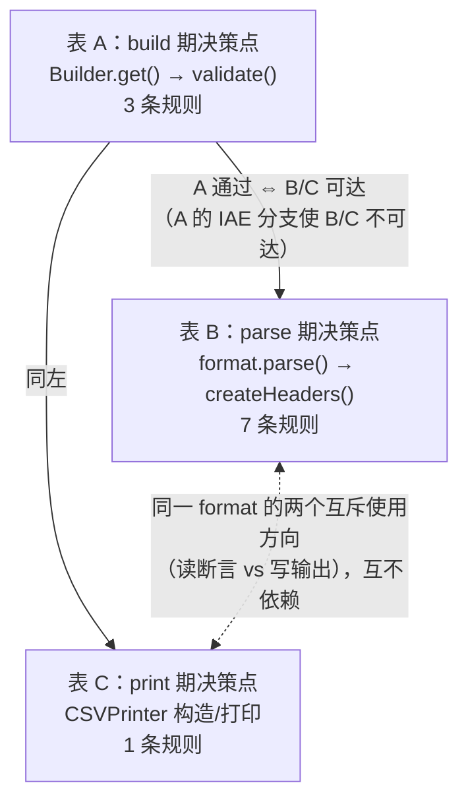

# 决策表测试法：`setRequiredHeaders` 验收测试用例设计

> **依据链**：本文所有条件、取值、动作均由 `ch03-2-adr.md`（下称 ADR，裁决 D1–D10，证据 E1–E15）导出；代码事实可在 `./commons-csv`（HEAD `24562da2`）按行号复核。断言口径沿用热身章约定：**异常类型精确断言，消息只断言关键片段**。用户已授权 ADR 全部裁决（对话 Round 0，Q0=c），本文按"少而精"原则控制用例数（M2）。
> **范围声明**（对话 Round 0，M4）：本文只覆盖新需求的行为契约；`get("nope")` 晚失败保留、全量 1003 例零破坏等**安全网回归不在范围内**（本次不改生产代码）。

---

## 0. 决策表类型选择与多表关系

**选择：Rule Based Decision Table（规则型决策表，附录 A 类型 5），表内以 extended 多值条件形式填格。**

理由（对照任务的真实复杂度）：

1. **条件之间存在门控/依赖关系，不是彼此独立的**。"存在结构性表头错误"门控所有 required 相关条件（ADR D3：结构错误绝对优先，此时差异形态、`ignoreHeaderCase` 全部失效）；"required 设置状态"门控"差异形态"是否有意义；"差异形态=仅大小写"又门控 `ignoreHeaderCase` 是否有区分力（ADR D2）。附录 A"局限性 3"明言标准决策表假设条件独立、存在约束时须识别并消除不可能组合——这正是本任务的核心复杂度，而 Rule Based 型就是为"multiple interacting conditions + layered business logic"设计的。
2. **动作分层跨越三个决策点**（build 期 / parse 期 / print 期），单一表格装不下（AC-1 发生在 `Builder.get()`，AC-4 在 `CSVParser` 构造，AC-5 在 `CSVPrinter`）。Rule Based 型要求"每条路径都能被显式定义和测试"，与三决策点拆表天然匹配。
3. **排除其他四型的具体理由**：Limited（全二值）装不下"表头模式 3 值、差异形态 4 值"的多值条件；Extended 处理多值但单表平铺，无法表达门控与多决策点分层；Condition Action 表要求条件与结果近似一对一映射，本任务是多条件交互决定动作，不成立；Switch 表要求单一主控条件分支，本任务无单一主控条件。

**拆成三张表，关系如下**：

- **表 A 是表 B、表 C 的前提**：只有 build 通过的配置才能到达 parse/print；表 A 的 `IAE` 分支（A-R2）直接终止后两张表的可达性。
- **表 B 与表 C 互斥独立**：同一份 format 要么用于读、要么用于写（ADR D4：写方向不消费 required），二者无依赖，是并列的两个决策点。

---

## Step 1：识别所有条件

### 1.1 正选条件（全部可追溯到证据或 ADR 裁决）

| 编号 | 条件 | 用于哪张表 | 追溯 |
| --- | --- | --- | --- |
| C1 | **表头配置模式**：配置里 `headers` 字段的形态 | 表 A | E8：`null`=无表头 / 空数组=自动探测首行 / 非空数组=手工指定（`getHeader()` javadoc `CSVFormat.java:1897` 原文"null if disabled, the empty array if to be read from the file"） |
| C2 | **requiredHeaders 设置状态** | 表 A、表 B | ADR D7：`null`、空数组、从未调用三者归一化为"未设置"；已设置 = ≥1 个名字 |
| C3 | **结构性表头错误存在性**：空名违规或重复名违规 | 表 B | E1（空名逐列抛，`:655-659`）+ E2（重复逐列抛，`:661-669`）+ ADR D3（结构错误优先门控） |
| C4 | **required 名单与实际表头的差异形态** | 表 B | ADR D2（匹配语义复用 `headerMap`）：这是"输入侧"可控变量；命中/缺失是它 × C5 的**结果**，不拿结果当条件 |
| C5 | **ignoreHeaderCase** | 表 B | E6（`:615-619`：`TreeMap(CASE_INSENSITIVE_ORDER)` vs `LinkedHashMap`）+ ADR D2（跟随该配置） |

### 1.2 排除的维度（看似条件、实被排除——判断"是否真正理解系统行为"的关键清单）

| 被排除维度 | 排除理由 | 追溯 |
| --- | --- | --- |
| 表头来源（自动探测 vs 手工指定）**作为表 B 条件** | 单点校验使两种模式行为完全一致；它只影响测试数据构造方式，不影响任何动作。降级为**变体**维度，在关键规则下用手工模式复测钉住一致性 | ADR D5、D9 |
| `trim` / `ignoreSurroundingSpaces` | 作用于表头 key 的**形成阶段**（`addRecordValue` `CSVParser.java:595`，先于映射建立、更先于校验），与 required 校验零交互。其存在感通过 C4 的"仅空白差异"取值间接覆盖（测试数据固定默认 `trim=false`） | E7、ADR D10 |
| `skipHeaderRecord` | 只决定手工模式下文件首行是否被读弃（`:643-648`），不改变映射来源，不改变校验结果 | E8、ADR D10 |
| `maxRows`、`trailingDelimiter`、`lenientEof`、`quote`/`escape`/`comment` 等方言参数 | 作用于记录读取或词法层，全部晚于或独立于表头校验；列为条件只会按 2^n 膨胀规则数而不产生新动作 | ADR D10；附录 A 局限性 1 |
| `DuplicateHeaderMode` 三值全展开 | 只需"结构错误**存在与否**"（C3 两档）。三值的细粒度语义（`ALLOW_EMPTY` 允许空白列重复）是现状行为、特征测试 C 组已钉住，非新需求验收；允许重复时 required 命中不受影响（E3 last-wins 只改索引不改存在性） | E2、E9、ADR D3 |
| required 名单自身重复 / 含空白名 | 重复不改变集合关系（重复查询不改变 `required ⊆ keySet` 判定）；空白名按普通名字匹配。均不特判——设条件只会制造无新动作的规则 | ADR D7 |
| 缺失程度（缺 1 列 / 缺部分 / 缺全部 / 空文件） | 同一判断逻辑的不同数据规模，动作同为"CSVException 缺列"，仅消息内容不同——是**变体**不是新规则 | ADR D1、D8 |
| `allowMissingColumnNames` 取值本身 | 它只是 C3"空名违规"的前置数据条件（false 时空名才抛），不与 required 产生任何交互 | E1 |
| 数据记录的内容、行数、格式 | 校验发生在 `CSVParser` 构造内（`:528`），先于任何数据记录产出——数据侧一切变量在校验时点尚不可见 | E11 |

---

## Step 2：定义每个条件的具体取值

| 条件 | 取值集合 | 精确性说明 |
| --- | --- | --- |
| C1 表头配置模式 | ① `无`（`headers == null`，从未调 `setHeader`）② `自动`（`setHeader()` 无参 → 空数组，表头从文件首行读）③ `手工`（`setHeader("a",…)` 非空数组） | 三值按 `getHeader()` javadoc（E8）的字段形态定义，可用 getter 直接观察，无歧义 |
| C2 requiredHeaders 状态 | ① `未设置`（从未调用，或 `setRequiredHeaders(null)`，或 `setRequiredHeaders()` 空数组——归一化后等价）② `已设置`（≥1 个非空名字） | "未设置"三种子形态**不构成可区分规则**（ADR D7 归一化），但其中"空数组"子形态派生 1 条变体钉住"不获得 `setHeader` 式的自动探测含义" |
| C3 结构性表头错误 | ① `无` ② `有`（= 存在 isBlank 列且 `allowMissingColumnNames=false`（空名违规），或存在重复列且 `duplicateHeaderMode=DISALLOW`（重复违规）） | 两类违规在"先于 required 抛"这一点上等价（ADR D3），故合并为一档；等价性由变体分别验证两类。"有"的判定标准直接引用 E1/E2 的抛出条件 |
| C4 差异形态 | ① `无差异`：每个 required 名 `r` 都存在表头 `h` 使 `h.equals(r)` ② `仅大小写`：存在 `h` 使 `h.equalsIgnoreCase(r) && !h.equals(r)`（对缺失的那些 r）③ `仅前后空白`：存在 `h` 使 `h.trim().equals(r) && !h.equals(r)` ④ `名字不存在`：以上皆非 | 每个取值给出可直接转成测试数据的谓词定义；测试数据固定 `trim=false`（默认）以隔离 E7 的干扰 |
| C5 ignoreHeaderCase | ① `false`（默认，`LinkedHashMap`）② `true`（`TreeMap(CASE_INSENSITIVE_ORDER)`） | 直接对应 E6 的两种 Map 实现 |

**"缺 1 列"与"缺全部列"为何是同一取值**：C4 的四个取值刻画的是**匹配语义的分叉**（相等 / 大小写折叠 / 空白不折叠 / 不存在），缺失数量不改变语义分支——4 值已完备刻画"命中与否"的全部机理；数量只影响 D1 消息的名单长度，故归入变体（TC-B7a/b/c/d）。

---

## Step 3：计算规则数

### 表 A（build 期）：C1(3) × C2(2) = 6 个理论组合

| 化简动作 | 组合数变化 | 理由 |
| --- | --- | --- |
| C2=未设置时，C1 三种模式结果同为"build 通过" → 合并为 1 条（C1 = –） | 3 → 1 | ADR D7：未设置即特性关闭，build 期无任何新增检查 |
| C2=已设置 × C1=无 → `IAE`@build，1 条 | 保留 1 | ADR D6：配置矛盾 fail-fast |
| C2=已设置 × C1∈{自动, 手工} 结果同为"build 通过、校验推迟" → 合并为 1 条 | 2 → 1 | ADR D5：单点校验，build 期对两种表头模式等价地不做交叉检查 |
| **表 A 规则数** | **6 → 3** | 无不可能组合（三种模式 × 两种状态都是可达配置） |

### 表 B（parse 期，前提 P：表 A 已通过）：C2(2) × C3(2) × C4(4) × C5(2) = 32 个理论组合

| 化简动作 | 组合数变化 | 理由 |
| --- | --- | --- |
| C2=未设置：C4、C5 无意义（无名单谈不上差异）→ 8 个差异维度组合坍缩 | 32 → 2×2×(C4,C5 视为 –) | 前提依赖：C4/C5 只在 C2=已设置时有定义 |
| 其中"C2=未设置 × C3=有（结构错误）"剔除 | −1 | **纯现状行为**（E1/E2 原样），特征测试 C 组（`CSVDuplicateHeaderTest`、kata `HeadersCharacterizationTest`）已钉住；按 M4 口径排除回归，非新需求验收 |
| C2=已设置 × C3=有：C4(4) × C5(2) = 8 个组合全部坍缩为 1 条（C4 = C5 = –） | 8 → 1 | ADR D3 门控：结构异常先抛，required 一切条件失效 |
| C2=已设置 × C3=无 × C4=无差异：C5 两值结果同 → 1 条（C5 = –） | 2 → 1 | ADR D2：无差异时大小写折叠规则不参与 |
| C2=已设置 × C3=无 × C4=仅大小写：C5 有区分力（false→缺失，true→命中）→ **保留 2 条** | 保留 2 | ADR D2 + E6：结果真的随 C5 变化，不可合并 |
| C2=已设置 × C3=无 × C4=仅空白：C5 两值结果同（均缺失）→ 1 条（C5 = –） | 2 → 1 | ADR D2：不 trim，与大小写规则无关 |
| C2=已设置 × C3=无 × C4=不存在：同上 → 1 条（C5 = –） | 2 → 1 | 同上 |
| **表 B 规则数** | **32 → 7** | 详见 Step 5 |

（"空白差异 × ignoreHeaderCase=true 是否可能命中"核对：`TreeMap(CASE_INSENSITIVE_ORDER)` 只折叠**大小写**、不剥空白，`" currency "` 与 `"currency"` 仍不相等——不存在被误删的可能组合。）

### 表 C（print 期，前提：携带 required 且 build 通过）

唯一条件"使用方向=写"恒真，无自由条件 → **1 条规则**（ADR D4：写方向不消费 required，恒为无操作）。理论组合即 1，无需化简。

**三表合计：3 + 7 + 1 = 11 条规则。**

---

## Step 4：识别所有动作

| 编号 | 动作 | 决策点 | 精确定义（异常类型 + 消息关键片段） | 追溯 |
| --- | --- | --- | --- | --- |
| AC-0 | **build 通过** | `Builder.get()` | 正常返回 `CSVFormat`；`getRequiredHeaders()` 返回 `null`（未设置时）或名单拷贝（E12 惯例） | D7 |
| AC-1 | **配置矛盾 `IllegalArgumentException`@build** | `validate()` | 消息含片段 `no header is defined`，建议全文 `Required headers [currency] are set but no header is defined` | D6 |
| AC-2 | **parse 构造成功，记录可按名访问** | `CSVParser` 构造返回 | `iterator()/next()` 首条数据记录可 `get("required 名")`；`getHeaderMap()` 含全部 required 名 | D2 |
| AC-3 | **现状结构异常 `IllegalArgumentException`@parse（先于 required）** | `createHeaders()` 循环内 | 空名版：消息含 `A header name is missing in`（E1 原文）；重复版：消息含 `The header contains a duplicate name`（E2 原文）。**类型断言必须是 `IllegalArgumentException` 而非 `CSVException`** | E1/E2、D3 |
| AC-4 | **缺必需列 `CSVException`@parse（构造期、首条数据记录前）** | `createHeaders()` 末尾 | 消息含片段 `Missing required header(s)` + 缺失名单（按声明序去重，形如 `[amount, currency]`）+ 实际表头（形如 `in [date, amount]`，空文件时 `in []`）。建议全文模板 `Missing required header(s) %s in %s` | D1、D8 |
| AC-5 | **print 正常（无校验）** | `CSVPrinter` 构造及打印 | 不抛任何异常；`getHeader() != null && !skipHeaderRecord` 时照常输出表头行（E13 行为零变化） | D4、E13 |

---

## Step 5：填充决策表

### 表 A：build 期决策点（`Builder.get()` → `validate()`）

| 条件/动作 | A-R1 | A-R2 | A-R3 |
| --- | --- | --- | --- |
| C1 表头配置模式 | – ¹ | 无 | 自动 或 手工 ² |
| C2 requiredHeaders 状态 | 未设置 | 已设置 | 已设置 |
| **AC-0 build 通过** | ✓ | | ✓（getter 返回名单拷贝） |
| **AC-1 `IAE`（`no header is defined`）** | | ✓ | |

### 表 B：parse 期决策点（`format.parse(reader)` → `createHeaders()`；前提：表 A 通过）

| 条件/动作 | B-R1 | B-R2 | B-R3 | B-R4 | B-R5 | B-R6 | B-R7 |
| --- | --- | --- | --- | --- | --- | --- | --- |
| C2 requiredHeaders 状态 | 未设置 | 已设置 | 已设置 | 已设置 | 已设置 | 已设置 | 已设置 |
| C3 结构性表头错误 | 无 | 有 ³ | 无 | 无 | 无 | 无 | 无 |
| C4 差异形态 | – ⁴ | – ⁵ | 无差异 | 仅大小写 | 仅大小写 | 仅前后空白 | 名字不存在 |
| C5 ignoreHeaderCase | – ⁴ | – ⁵ | – ⁶ | false | true | – ⁷ | – ⁷ |
| **AC-2 parse 成功可按名访问** | ✓（现状零变化） | | ✓ | | ✓ | | |
| **AC-3 现状结构 `IAE` 先抛** | | ✓ | | | | | |
| **AC-4 `CSVException` 缺列** | | | | ✓ | | ✓ | ✓ |

### 表 C：print 期决策点（前提：携带 required 且 build 通过）

| 条件/动作 | C-R1 |
| --- | --- |
| 使用方向 | 写（`format.print(...)` / `new CSVPrinter(...)`） |
| requiredHeaders 状态 | 已设置（恒真前提，不自由） |
| **AC-5 print 正常，零校验** | ✓ |

---

## Step 6：化简说明（逐个 "–" 的理由）

| 上标 | 位置 | 为什么该条件在此规则下真的不重要 |
| --- | --- | --- |
| ¹ | A-R1 × C1 | C2=未设置即特性关闭（D7 归一化），`validate()` 对表头模式本来就没有 required 相关检查——三种模式都原样通过 build（方言检查与 C1 无关且属现状） |
| ² | A-R3 × C1 | D5 单点校验裁决：build 期对自动/手工模式**等价地**不做 required ⊆ headers 交叉检查（避免 E5 式大小写分叉）；两值结果同为"通过、推迟"，故合并为一格 |
| ³ | B-R2 × C3 | "有"合并空名/重复两类违规：二者都使循环在到达 required 校验前抛 `IAE`（E1 `:658` 先于 E2 `:665`，二者又都先于循环末尾的校验点，D3）——对"先于 required"这一被测行为完全等价，等价性由变体 TC-B2a/b 分别钉住 |
| ⁴ | B-R1 × C4/C5 | C2=未设置时名单不存在，"差异形态"与"大小写折叠"都无从谈起——不是"不影响结果"，是**前提上无定义**（Step 3 第一行化简的落格体现） |
| ⁵ | B-R2 × C4/C5 | D3 门控：结构异常在循环内逐列抛出时，`headerMap` 尚未建全，缺失判定既不可能也无意义；变体 TC-B2c（required 全部命中 + 结构错误）实证此 "–"：结果仍抛结构 `IAE` |
| ⁶ | B-R3 × C5 | 名字逐字符相等（`equals`）时，`CASE_INSENSITIVE_ORDER` 折叠与否不影响命中——折叠规则只在"仅大小写差异"时才参与判定（D2） |
| ⁷ | B-R6/B-R7 × C5 | 空白不折叠（`" currency "` 与 `"currency"` 在 `TreeMap(CASE_INSENSITIVE_ORDER)` 下仍不等，Step 3 已核对）；名字不存在同理——两种形态下大小写规则都无参与点（D2） |

**不可能组合核对**：三张表中不存在逻辑不可能的组合——表 B 理论组合里唯一的前提性不可能（C2=已设置 × C1=无）已在表 A 被 AC-1 截断为"表 B 不可达"，Step 3 的化简已把它留在表 A；"仅大小写 × C5 无区分力"不存在（这正是 B-R4/B-R5 保留 2 条的原因）。

---

## Step 7：规则 → 验收测试用例

统一约定：`F(**)` 表示 `CSVFormat.DEFAULT.builder()` 起步；默认 `required = ("date","amount","currency")`；断言口径 = 异常类型精确 + 消息片段；"构造期抛"的断言方式为 `format.parse(reader)` 调用即抛（`CSVParser` 构造内 `:528` 调 `createHeaders()`，E11），**不需要** `iterator()` 触发——这本身就是"首条记录之前"时点的验收点。

### 表 A 用例

| 用例 | 规则 | 前置条件 | 测试数据 | 预期结果 |
| --- | --- | --- | --- | --- |
| **TC-A1** | A-R1 | 无 | `F().get()`；再取 `F().setHeader().get()`、`F().setHeader("a").get()` | 均正常返回（AC-0）；`getRequiredHeaders()` 返回 `null` |
| **TC-A1a**（变体） | A-R1 | 无 | `F().setRequiredHeaders(null).get()` 与 `F().setRequiredHeaders().get()` | 均正常返回且 getter 为 `null`——钉住 D7"null/空数组=未设置"归一化，**空数组不获得 `setHeader` 式自动探测含义**（E8 陷阱） |
| **TC-A2** | A-R2 | 无 | `F().setRequiredHeaders("date","amount","currency").get()`（**不**调 `setHeader`） | `assertThrows(IllegalArgumentException)`，消息含 `no header is defined`（AC-1） |
| **TC-A3a** | A-R3 | 无 | `F().setHeader().setRequiredHeaders("date","amount","currency").get()` | 正常返回（AC-0），`getRequiredHeaders()` 返回 3 元素拷贝（与 set 顺序一致） |
| **TC-A3b**（变体） | A-R3 | 无 | `F().setHeader("date","amount","currency").setRequiredHeaders("date","amount").get()` | 正常返回（AC-0）——手工模式同样不在 build 期抛（D5，对照重复列名的双时机先例 E4/E5） |

### 表 B 用例（除注明外均自动探测模式：`setHeader()`）

| 用例 | 规则 | 前置条件 | 测试数据（文件内容） | 预期结果 |
| --- | --- | --- | --- | --- |
| **TC-B1** | B-R1 | 无 | `F().setHeader()`；文件 `date,amount,currency\n1,2,USD\n` | `parse()` 构造成功；首条记录 `get("currency")=="USD"`（AC-2）——特性默认关闭、现状零变化 |
| **TC-B2a** | B-R2 | `allowMissingColumnNames=false`（默认） | `F().setHeader().setRequiredHeaders("currency")`；文件表头行 `date,,currency\n`（缺 `amount` 名单不在其中、含空列名） | `assertThrows(IllegalArgumentException)`，消息含 `A header name is missing in`（AC-3）——**不是** `CSVException`，钉住 D3 优先级 |
| **TC-B2b**（变体） | B-R2 | `setDuplicateHeaderMode(DISALLOW)` | 文件表头行 `date,date,currency` + required `("amount","currency")` | `assertThrows(IllegalArgumentException)`，消息含 `The header contains a duplicate name`（AC-3 重复版） |
| **TC-B2c**（变体） | B-R2 | 同 TC-B2a | 文件表头行 `date,,currency` + required `("currency")`（**全部命中**） | 仍抛空名 `IAE`（AC-3）——实证 B-R2 行 C4 的 "–"：required 命中与否不改变结构错误优先 |
| **TC-B3** | B-R3 | 无 | `F().setHeader().setRequiredHeaders("date","amount","currency")`；文件 `date,amount,currency\n1,2,USD\n` | 构造成功；`getHeaderMap()` 含 3 个 required 名；首条记录 `get("currency")=="USD"`（AC-2） |
| **TC-B3a**（变体） | B-R3 | 手工模式 | `F().setHeader("date","amount","currency").setSkipHeaderRecord(true).setRequiredHeaders(...)`；文件首行**故意写歪** `DATE,AMT,CUR\n`（将被 skip 掉） | 构造成功（AC-2）——钉住 D5/D9：手工模式行为与自动一致、对照手工名单 |
| **TC-B4** | B-R4 | `ignoreHeaderCase=false`（默认） | 文件表头行 `Date,AMOUNT,currency` + required 全 3 名 | `assertThrows(CSVException)`，消息含 `Missing required header(s)` 且缺失名单为 `[date, amount]`（AC-4；`currency` 命中） |
| **TC-B5** | B-R5 | `setIgnoreHeaderCase(true)` | 同 TC-B4 数据 | 构造成功；首条记录 `get("amount")` 与 `get("AMOUNT")` 均命中同一值（AC-2）——钉住 D2"复用同一张 `CASE_INSENSITIVE` map"（E6） |
| **TC-B6** | B-R6 | 无 | 文件表头行 `date,amount,␠currency␠`（currency 带前后空格，trim=false 默认） | `assertThrows(CSVException)`，消息含 `Missing required header(s) [currency]` 且实际表头片段可见带空格形态（AC-4）——钉住 D2"不 trim" |
| **TC-B7a** | B-R7 | 无 | 文件表头行 `date,amount` + required 全 3 名 | `assertThrows(CSVException)`，消息含 `Missing required header(s) [currency] in [date, amount]`（AC-4；缺 1 列） |
| **TC-B7b**（变体） | B-R7 | 无 | 文件表头行 `date` | 消息缺失名单 `[amount, currency]`——**按声明序**（D1 消息确定性） |
| **TC-B7c**（变体） | B-R7 | 无 | 文件表头行 `foo,bar` | 缺失名单 `[date, amount, currency]`（缺全部） |
| **TC-B7d**（变体） | B-R7 | 无 | **空文件**（0 字节）+ `setHeader()` | `assertThrows(CSVException)`，消息实际表头为 `in []`（AC-4 + D8：空文件不特判、空 map 全缺） |
| **TC-B7e**（变体） | B-R7 | 手工模式 | `setHeader("date","amount")` + required `("currency",)`；文件首行**含** `date,amount,currency`（被当数据记录读） | 仍抛 `CSVException` 缺 `[currency]`——钉住 D9：对照**手工名单**而非文件首行 |
| **TC-B7f**（变体） | B-R7 | 无 | `setRequiredHeaders("currency","currency")`；文件表头行 `date,amount` | 消息缺失名单为 `[currency]`（去重，D7）——钉住"名单重复不抛配置错、报缺失去重保序" |

### 表 C 用例

| 用例 | 规则 | 前置条件 | 测试数据 | 预期结果 |
| --- | --- | --- | --- | --- |
| **TC-C1** | C-R1 | 表 A 通过的手工表头 format | `F().setHeader("date","amount","currency").setRequiredHeaders("date","amount","currency")` → `format.print(sw)`，再 `printRecord("1","2","USD")` | 构造与打印全程不抛（AC-5）；输出首行为 `date,amount,currency`（E13 行为零变化）；**即便**随后只打印部分列的数据也不校验——钉住 D4 |

---

## 汇总表

| 决策表 | 规则数 | 用例数（含变体） | 覆盖的 ADR 裁决 | 覆盖的证据 |
| --- | --- | --- | --- | --- |
| 表 A（build 期） | 3 | 5（TC-A1、A1a、A2、A3a、A3b） | D5、D6、D7 | E4、E5、E8、E12 |
| 表 B（parse 期） | 7 | 15（TC-B1、B2a–c、B3、B3a、B4、B5、B6、B7a–f） | D1、D2、D3、D5、D7、D8、D9 | E1、E2、E3、E6、E7、E8、E11 |
| 表 C（print 期） | 1 | 1（TC-C1） | D4 | E13 |
| **合计** | **11** | **21** | D1–D10 全覆盖 | — |

**规则 ↔ 用例追溯**：每条规则至少 1 个正例；B-R2、B-R3、B-R7 各有 2–6 个变体，变体均标注了它钉住的具体裁决（D3 优先级 / D5·D9 模式一致性 / D1 消息序 / D7 去重 / D8 空文件）。任何一个用例拿去复述，都能从"规则 → ADR 裁决 → 证据行号"三级追溯回答"验证哪条业务规则、输入什么、期望什么"。
